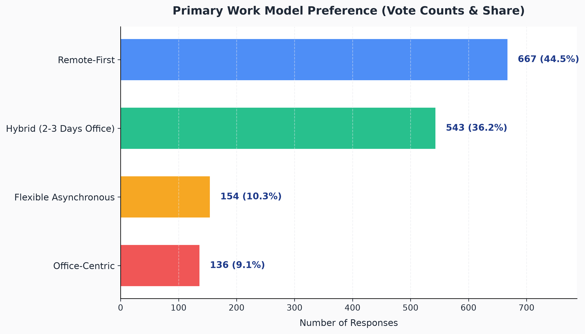
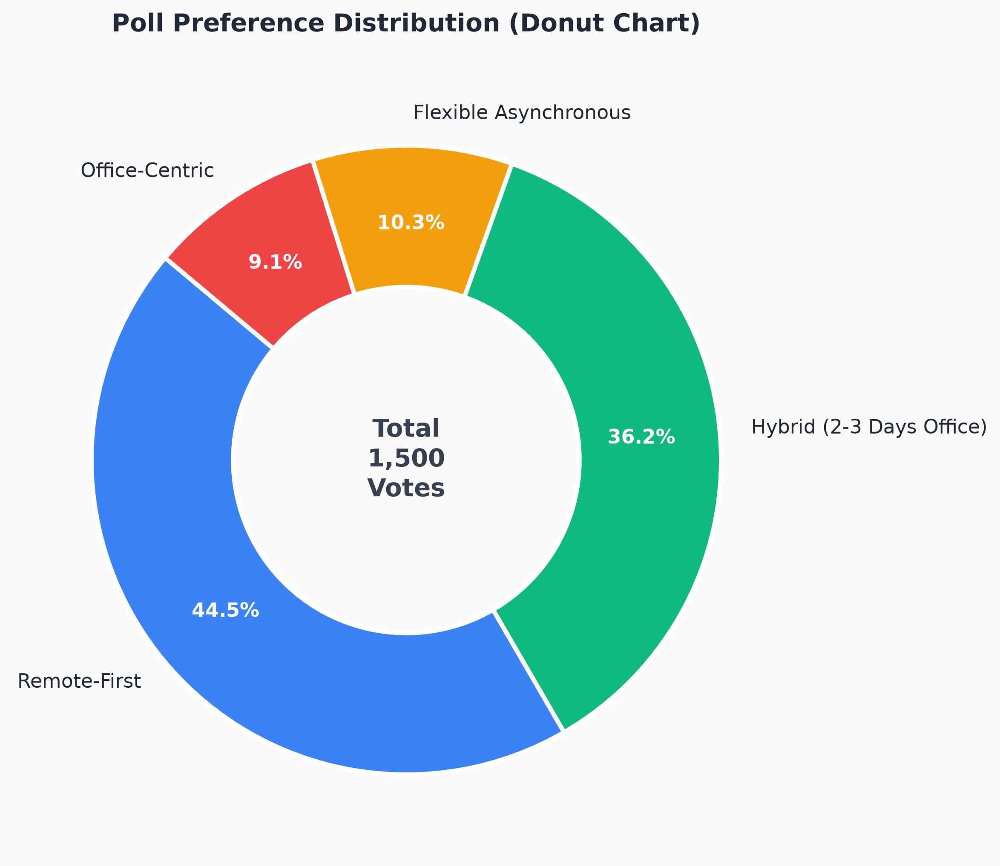
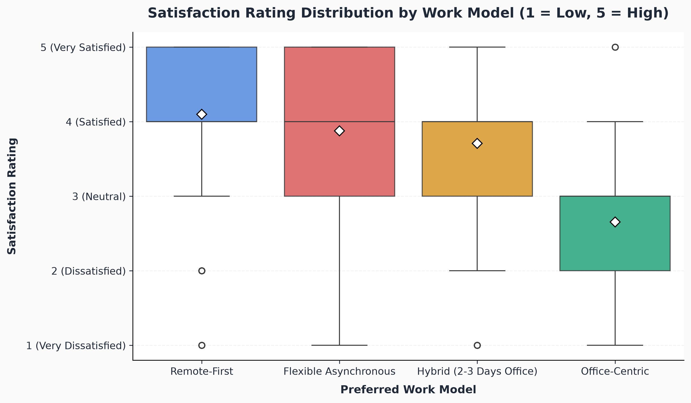
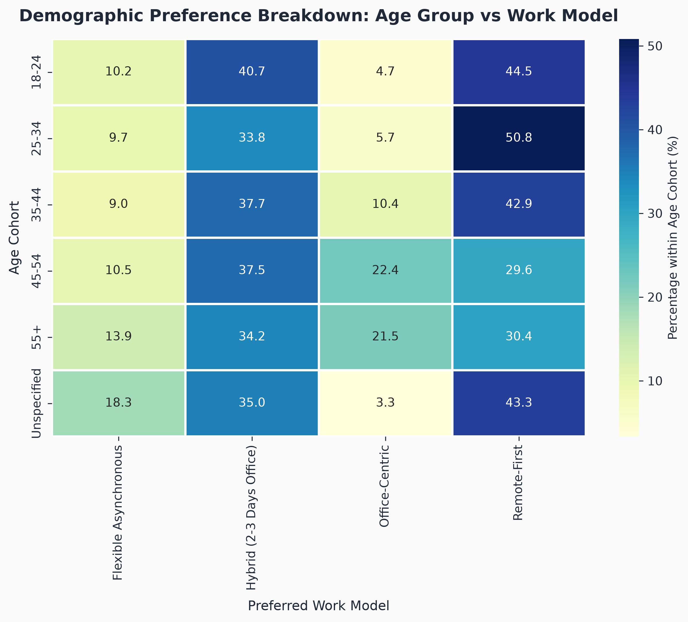
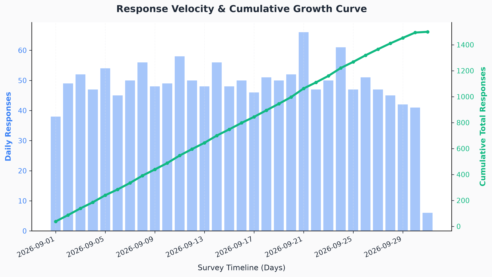
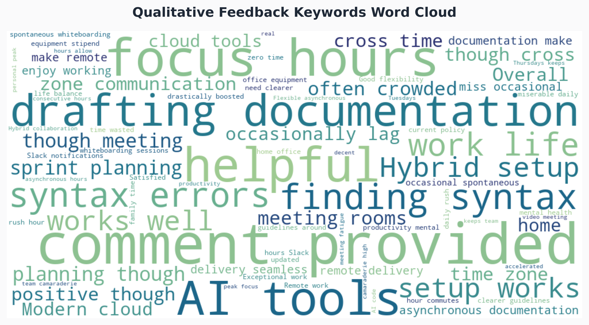

# 📊 Poll Results Visualizer

[](https://www.python.org/)
[](https://streamlit.io/)
[](https://pandas.pydata.org/)
[](https://plotly.com/)
[](LICENSE)
[](#)

> **A production-grade, end-to-end data analytics and visualization system for public polls and corporate surveys.**  
> Features automated dirty-data cleansing, statistical cross-tabulations, automated narrative insight synthesis, publication-ready static charts, and an interactive modern Streamlit analytics dashboard.

---

## 📌 Table of Contents
- [Project Overview](#-project-overview)
- [Key Features](#-key-features)
- [Architecture & Workflow](#-architecture--workflow)
- [Project Directory Structure](#-project-directory-structure)
- [Dataset Specifications](#-dataset-specifications)
- [Installation & Setup](#-installation--setup)
- [Usage Guide](#-usage-guide)
  - [1. CLI Pipeline (`main.py`)](#1-cli-pipeline-mainpy)
  - [2. Interactive Streamlit Dashboard (`app.py`)](#2-interactive-streamlit-dashboard-apppy)
- [Analytical Findings & Sample Results](#-analytical-findings--sample-results)
- [Visualization Gallery](#-visualization-gallery)
- [Data Cleaning & Validation Audit](#-data-cleaning--validation-audit)
- [GitHub Commands & Commit Guide](#-github-commands--commit-guide)
- [License & Contributing](#-license--contributing)

---

## 🚀 Project Overview

The **Poll Results Visualizer** is designed to transform raw, imperfect survey feedback into actionable intelligence. Survey data collected in the real world is notorious for inconsistent casing, rogue whitespace padding, duplicated clicks, out-of-bounds ratings, and unstandardized demographic entries.

This project delivers:
1. **Synthetic Data Engine**: Generates realistic, reproducible survey data with realistic correlations and controlled anomalies for benchmarking.
2. **Robust Cleaning & Validation Pipeline**: Deduplicates, sanitizes strings, corrects out-of-bounds metrics, and safely imputes missing values.
3. **Statistical Analysis & Automated Narrative Insights**: Calculates frequencies, percentage distributions, cohort cross-tabulations, and algorithmic summary text.
4. **Dual Visualization Suite**: Generates 300-DPI publication figures (Matplotlib, Seaborn, WordCloud) and interactive web visualisations (Plotly).
5. **Interactive Executive Dashboard**: A multi-tab Streamlit dashboard with real-time dynamic filtering, KPI scorecards, and artifact exports.

---

## ✨ Key Features

- **🛡️ Defensive Data Cleaning**: Automatically purges duplicate respondents, rectifies text casing (e.g. `remote-first` vs `Remote-First`), trims padding whitespaces, and imputes missing ratings via group median strategies.
- **🧠 Automated Narrative Insights**: Dynamically generates natural-language findings (identifying plurality winners, satisfaction disparities, and demographic affinities) without hard-coded assumptions.
- **📊 6 Publication-Grade Static Visualizations**:
  - Horizontal Vote Count & Percentage Bar Chart
  - Preference Share Donut Chart with center total callout
  - Satisfaction Rating Distribution Boxplot (with mean diamonds)
  - Age Cohort vs Preferred Model Heatmap
  - Survey Response Velocity & Cumulative Trajectory Curve
  - Qualitative Feedback Lexical Word Cloud
- **🎛️ Interactive Streamlit Dashboard (`app.py`)**:
  - **KPI Scorecards**: Total responses, leading choice, star-rated mean satisfaction, Net Satisfaction Score.
  - **Dynamic Multi-Filters**: Filter by Preferred Option, Geographic Region, Age Cohort, Satisfaction Rating, and Date Range.
  - **5 Comprehensive Tabs**: Executive Overview, Demographic Deep-Dive, Satisfaction & Feedback, Timeline Velocity, and Data Explorer & Audit Hub.
  - **Custom CSV Ingestion**: Upload your own raw survey CSV and run the cleaning and analytics pipeline instantaneously.
  - **Export Center**: Export filtered datasets as CSV, analytical summaries as JSON, and full executive reports as Markdown.

---

## 🏗️ Architecture & Workflow

```mermaid
flowchart TD
    A[Raw Data Source\n(Custom CSV or Synthetic Generator)] --> B[Data Cleaning & Validation Pipeline\nsrc/cleaner.py]
    B -->|Deduplication & Imputation| C[(Cleaned Data\ndata/cleaned_poll_results.csv)]
    C --> D[Statistical Analysis Engine\nsrc/analyzer.py]
    C --> E[Visualization Suite\nsrc/visualizer.py]
    D --> F[Summary Reports\noutputs/summary_report.md & .json]
    E --> G[Static Figures 300 DPI\noutputs/ & images/]
    C & D & E --> H[Interactive Streamlit Dashboard\napp.py]
    H --> I[Executive KPI Cards & Plotly Charts]
    H --> J[Filtered Data & Report Exports]
```

---

## 📂 Project Directory Structure

```text
Poll Results Visualize/
│
├── data/
│   ├── raw_poll_responses.csv       # Raw synthetic survey data with injected noise
│   └── cleaned_poll_results.csv     # Verified, deduplicated, clean dataset
│
├── src/
│   ├── __init__.py                  # Package initialization
│   ├── generator.py                 # Synthetic survey generator with controlled noise
│   ├── cleaner.py                   # Data validation, normalization & deduplication
│   ├── analyzer.py                  # Statistical metrics & dynamic narrative insights
│   └── visualizer.py                # Matplotlib, Seaborn, WordCloud & Plotly charts
│
├── outputs/                         # Pipeline output artifacts
│   ├── 01_vote_distribution_bar.png
│   ├── 02_preference_share_donut.png
│   ├── 03_satisfaction_distribution.png
│   ├── 04_demographic_heatmap.png
│   ├── 05_time_trend_trajectory.png
│   ├── 06_feedback_wordcloud.png
│   ├── summary_report.json          # Machine-readable analytical output
│   └── summary_report.md            # Human-readable executive markdown report
│
├── images/                          # High-resolution figures for documentation
│   ├── 01_vote_distribution_bar.png
│   ├── 02_preference_share_donut.png
│   ├── 03_satisfaction_distribution.png
│   ├── 04_demographic_heatmap.png
│   ├── 05_time_trend_trajectory.png
│   └── 06_feedback_wordcloud.png
│
├── app.py                           # Interactive Streamlit Web Application
├── main.py                          # CLI orchestrator & end-to-end pipeline runner
├── requirements.txt                 # Pinned project dependencies
├── .gitignore                       # Git exclusion rules
└── README.md                        # Portfolio documentation
```

---

## 📋 Dataset Specifications

The benchmark dataset models a worldwide survey: **"Future of Work & AI Tool Adoption Poll 2026"**.

| Field | Type | Description | Sample Values |
| :--- | :--- | :--- | :--- |
| `respondent_id` | String | Unique survey submission identifier | `RESP-00042` |
| `timestamp` | Datetime | Submission date and time (30-day window) | `2026-09-14 14:22:05` |
| `preferred_option` | Categorical | Primary work model preference | `Remote-First`, `Hybrid (2-3 Days Office)`, `Office-Centric`, `Flexible Asynchronous` |
| `satisfaction_rating` | Integer | Overall job/policy satisfaction (1 to 5) | `1`, `2`, `3`, `4`, `5` |
| `region` | Categorical | Geographic location of respondent | `North America`, `Europe`, `Asia-Pacific`, `Latin America`, `Middle East & Africa` |
| `age_group` | Categorical | Demographic age cohort | `18-24`, `25-34`, `35-44`, `45-54`, `55+` |
| `industry` | Categorical | Employment sector | `Technology & Software`, `Finance & Banking`, `Healthcare`, etc. |
| `ai_adoption_level` | Categorical | Daily AI tooling integration level | `Daily Power User`, `Occasional User`, `Exploring / Learning`, `Not Using AI` |
| `feedback` | String | Qualitative open-ended text remarks | *"Remote work has drastically boosted my productivity..."* |
| `is_synthetic` | Boolean | Audit indicator distinguishing generated data | `True` |

---

## ⚙️ Installation & Setup

### Prerequisites
- Python 3.10, 3.11, 3.12, or 3.14
- Git (optional, for version control)

### Step 1: Clone or Navigate to the Workspace
```bash
cd "Poll Results Visualize"
```

### Step 2: Create and Activate a Virtual Environment
```bash
# Windows (PowerShell)
python -m venv venv
.\venv\Scripts\Activate.ps1

# macOS / Linux
python3 -m venv venv
source venv/bin/activate
```

### Step 3: Install Required Dependencies
```bash
pip install -r requirements.txt
```

---

## 💻 Usage Guide

### 1. CLI Pipeline (`main.py`)
Run the entire end-to-end pipeline (generation, cleaning, statistical analysis, and plot rendering) with one command:

```bash
# Default execution (1,500 synthetic samples, seed=42)
python main.py

# Custom sample size and random seed
python main.py --samples 2500 --seed 999

# Run pipeline on your own custom survey CSV
python main.py --input-file data/my_custom_survey.csv
```

#### Terminal Output Highlights:
```text
===========================================================================
        POLL RESULTS VISUALIZER - COMPREHENSIVE PIPELINE
===========================================================================
[Phase 1/4] Generating reproducible synthetic dataset (1,500 respondents, seed=42)...
 -> Raw dataset saved: data/raw_poll_responses.csv (1,542 rows with intentional anomalies)

[Phase 2/4] Executing Data Cleaning & Validation Pipeline...
 -> Deduplication: Removed 42 duplicate submissions.
 -> Bounds Validation: Corrected 18 invalid ratings.
 -> Imputation: Imputed 101 missing satisfaction ratings.
 -> Clean Verified Records: 1,500

[Phase 3/4] Performing Statistical Analysis & Extracting Insights...
 -> Leading Choice: Remote-First (44.47% | 667 votes)
 -> Runner-Up:      Hybrid (2-3 Days Office) (36.2% | 543 votes)
 -> Mean Satisfaction: 3.80 / 5.0 (Std Dev: 1.12)
 -> Net Satisfaction Score: +55.8%

[Phase 4/4] Rendering High-Resolution Charts (Matplotlib, Seaborn, WordCloud)...
 -> All 6 static figures successfully rendered and exported to outputs/ and images/.
```

---

### 2. Interactive Streamlit Dashboard (`app.py`)
Launch the interactive web dashboard locally:

```bash
python -m streamlit run app.py
```
Open your browser at `http://localhost:8501` to explore:
- **Interactive Plotly Charts**: Zoom, pan, hover, and download interactive visualisations.
- **Sidebar Filters**: Real-time filtering by Work Model, Region, Age Group, Satisfaction Rating, and Date Window.
- **Custom CSV Ingestion**: Upload custom survey files and view instant automated cleaning and analysis.
- **Artifact Downloads**: Export cleaned datasets (CSV), statistical findings (JSON), or executive summaries (Markdown).

---

## 📈 Analytical Findings & Sample Results

Based on the 1,500 verified respondents benchmark:

### 1. Executive Summary
- **Total Valid Responses**: `1,500`
- **Plurality Winner**: **Remote-First** (`44.47%`, 667 votes)
- **Runner-Up Choice**: **Hybrid (2-3 Days Office)** (`36.20%`, 543 votes)
- **Office-Centric Share**: `10.27%` (154 votes)
- **Flexible Asynchronous Share**: `9.07%` (136 votes)
- **Overall Mean Satisfaction**: `3.80 / 5.0`
- **Net Satisfaction Score**: `+55.8%` (69.6% high satisfaction vs 13.8% low satisfaction)

### 2. Option Vote Breakdown Table
| Preferred Option | Total Votes | Vote Share (%) | Mean Satisfaction | Std Dev |
| :--- | :---: | :---: | :---: | :---: |
| **Remote-First** | 667 | 44.47% | **4.10 / 5.0** | 1.01 |
| **Hybrid (2-3 Days Office)** | 543 | 36.20% | **3.69 / 5.0** | 1.07 |
| **Office-Centric** | 154 | 10.27% | **2.65 / 5.0** | 1.19 |
| **Flexible Asynchronous** | 136 | 9.07% | **3.97 / 5.0** | 1.05 |

---

## 🖼️ Visualization Gallery

All charts are dynamically generated at 300 DPI and stored in `outputs/` and `images/`.

### 1. Vote Distribution & Share


---

### 2. Preference Share (Donut Chart)


---

### 3. Satisfaction Rating Distribution


---

### 4. Demographic Preference Heatmap (Age vs Work Model)


---

### 5. Response Velocity & Cumulative Growth


---

### 6. Qualitative Feedback Word Cloud


---

## 🛡️ Data Cleaning & Validation Audit

The pipeline includes transparent audit logging to verify data integrity:

| Cleaning Step | Raw Input Condition | Action Taken | Clean Result |
| :--- | :--- | :--- | :--- |
| **Deduplication** | 42 duplicate respondent submissions | Purged duplicate `respondent_id` rows, keeping first instance | 1,500 unique respondents |
| **Text Normalization** | Mixed case (`remote-first`, `REMOTE`, ` Hybrid `) | Trimmed whitespace and mapped to canonical Title Case | Clean categorical columns |
| **Bounds Validation** | 18 ratings with values `< 1` or `> 5` | Flagged out-of-bounds ratings and converted to NaN | Valid integer scale [1, 5] |
| **Rating Imputation** | 101 missing or corrupted ratings | Imputed using conditional median for that respondent's preferred option | Zero missing ratings |
| **Demographics** | 63 missing age groups, 145 blank feedback | Imputed with `"Unspecified"` and `"No comment provided"` | 100% complete records |

---

## 🐙 GitHub Commands & Commit Guide

Follow these steps to stage and commit your project locally. **(Do not push without configuring your remote repository credentials):**

### Step 1: Initialize Git Repository (if not already initialized)
```bash
git init
```

### Step 2: Check Status & Stage Files
```bash
git status
git add .
```

### Step 3: Recommended Commit Messages

#### Commit 1: Project Scaffolding & Dependencies
```bash
git commit -m "feat(scaffold): initialize poll results visualizer structure and dependencies"
```

#### Commit 2: Synthetic Data Engine & Cleaning Pipeline
```bash
git commit -m "feat(pipeline): add reproducible survey generator and robust data cleaner"
```

#### Commit 3: Statistical Analysis & Visualization Engine
```bash
git commit -m "feat(analytics): add statistical engine, automated narrative insights, and publication charts"
```

#### Commit 4: Interactive Streamlit Dashboard
```bash
git commit -m "feat(dashboard): build multi-tab interactive Streamlit dashboard with dynamic filters and exports"
```

#### Commit 5: Documentation & Production Polish
```bash
git commit -m "docs: add comprehensive portfolio README with architecture diagrams and visualization gallery"
```

### Step 4: Connecting to GitHub (When ready to push)
```bash
# 1. Create a repository on GitHub (e.g. 'poll-results-visualizer')
# 2. Link your local repo to GitHub
git remote add origin https://github.com/<your-username>/poll-results-visualizer.git

# 3. Rename branch to main
git branch -M main

# 4. Push to remote (requires user permission)
git push -u origin main
```

---

## 📄 License & Contributing

Distributed under the **MIT License**. Feel free to use, adapt, and build upon this project for educational, personal, or professional portfolio work.

Contributions and enhancements (e.g., adding NLP sentiment classification, PDF report generation, or multi-language survey support) are warmly welcomed!
